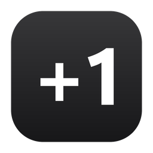
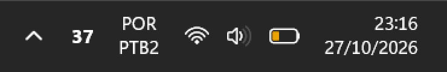
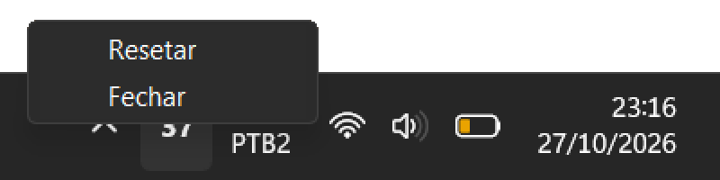

<p align="center">
  
</p>

<h1 align="center">Counter</h1>

<p align="center">
  Um contador que mora na bandeja do Windows, ao lado do relógio: só o número, sem janela, sem distração.
</p>

<p align="center">
  
  
  
  
  
</p>

<p align="center">
  
</p>

## Sobre

O Counter conta qualquer coisa (questões resolvidas, copos de água, repetições) sem ocupar espaço na tela. O número fica na barra de tarefas, com a mesma fonte, o mesmo branco e a mesma nitidez do relógio do Windows, e muda com um atalho de teclado de dentro de qualquer programa.

É um programa nativo em C++: cerca de **170 KB**, **~4 MB de memória** e **zero processamento** enquanto você não mexe nele.

## Funcionalidades

- **Número na bandeja**: o ícone é o próprio número, em negrito, centralizado e desenhado no tamanho exato em pixels da sua tela (sem borrar em 125%, 150%...).
- **Atalhos globais**: <kbd>Ctrl</kbd> + <kbd>Shift</kbd> + <kbd>→</kbd> soma 1 e <kbd>Ctrl</kbd> + <kbd>Shift</kbd> + <kbd>←</kbd> tira 1, funcionando em qualquer programa.
- **Menu no clique**: clique no número para abrir **Resetar** e **Fechar**. Com o menu aberto, <kbd>←</kbd> e <kbd>→</kbd> também mudam o número.
- **Resetar com confirmação**: o primeiro clique pergunta, o segundo zera. Nada de zerar sem querer.
- **Tema claro e escuro**: o número fica branco na barra escura e preto na clara, e o menu acompanha o tema do Windows. Troca sozinho se você mudar o tema.
- **Nunca perde a contagem**: o valor é salvo a cada mudança, com cópia de segurança, e continua de onde parou ao abrir de novo.

<p align="center">
  
</p>

## Como usar

1. Baixe o `Counter.exe` na página de **[Releases](../../releases/latest)** e abra. Não precisa instalar nada.
2. O número aparece na bandeja. No Windows 11, ícones novos ficam escondidos dentro da setinha <kbd>^</kbd>: **arraste o número para fora**, ao lado da seta, ou ligue o **Counter** em *Configurações → Personalização → Barra de tarefas → Outros ícones da bandeja do sistema*. O Windows lembra dessa escolha.

| Onde | O que faz |
|---|---|
| <kbd>Ctrl</kbd> + <kbd>Shift</kbd> + <kbd>→</kbd> | Soma 1 (em qualquer programa) |
| <kbd>Ctrl</kbd> + <kbd>Shift</kbd> + <kbd>←</kbd> | Tira 1 (em qualquer programa) |
| Clique no número | Abre o menu **Resetar** / **Fechar** |
| <kbd>→</kbd> / <kbd>←</kbd> com o menu aberto | Soma / tira 1 sem fechar o menu |
| <kbd>Esc</kbd> ou clique fora | Fecha o menu |

> Enquanto o Counter está aberto, <kbd>Ctrl</kbd> + <kbd>Shift</kbd> + <kbd>←</kbd>/<kbd>→</kbd> deixa de selecionar palavras nos outros programas (o Windows entrega o atalho só para ele). Ao fechar o Counter, volta ao normal.

O valor fica em `%APPDATA%\Counter\config.json`, com uma cópia de segurança em `config.backup.json`.

## Como compilar

Requisito: **Visual Studio** (a versão Community é gratuita) com a carga **Desenvolvimento para desktop com C++**.

Clone o repositório e, dentro da pasta, rode:

```bat
build.bat
```

O `Counter.exe` aparece na própria pasta. Ele não depende de nada além do Windows: dá para copiar e usar em qualquer PC.

Para mudar o ícone do app, edite o [`make_icon.py`](make_icon.py) e gere de novo (requer Python com Pillow):

```bash
python make_icon.py Counter.ico previa.png
```

## Destaques técnicos

- **Tudo num único arquivo comentado**: [`Counter.cpp`](Counter.cpp), só com a API do Windows, sem frameworks.
- **Zero processamento parado**: o programa dorme em `GetMessage` e só acorda quando o Windows avisa de um clique, um atalho (`RegisterHotKey`) ou uma troca de tema.
- **Mesmo texto do relógio**: o número é desenhado com **DirectWrite** (o motor de texto da barra de tarefas) na fonte Segoe UI Variable, no tamanho exato do ícone para a escala da tela (`GetSystemMetricsForDpi`).
- **Pouca memória**: o Direct2D desenha por software (`D2D1_RENDER_TARGET_TYPE_SOFTWARE`). Para um ícone de 20 pixels é instantâneo e evita carregar o driver da placa de vídeo, que sozinho ocuparia dezenas de MB.
- **Setas dentro do menu**: um gancho `WH_MSGFILTER` intercepta <kbd>←</kbd>/<kbd>→</kbd> enquanto o menu nativo está aberto, sem fechá-lo.
- **Dados à prova de perda**: gravação atômica (arquivo temporário + `ReplaceFile`) com backup automático.
- **Robusto**: só uma cópia roda por vez (`Mutex`) e o ícone volta sozinho se o Explorer reiniciar (`TaskbarCreated`).
- **`.exe` enxuto**: compilado com `/O1 /MT`, sem dependência das DLLs do Visual C++.

## Estrutura

```
Counter/
├── Counter.cpp     # todo o código do app, comentado
├── Counter.rc      # embute o ícone no .exe
├── Counter.ico     # ícone do app (16 a 256 px)
├── build.bat       # compila o Counter.exe
├── make_icon.py    # gera o Counter.ico
└── docs/           # imagens deste README
```

## Licença

Código sob a licença [MIT](LICENSE).

---

Feito por **Vitor Gabriel**.
